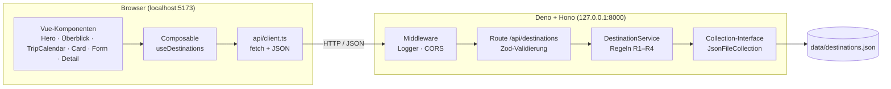
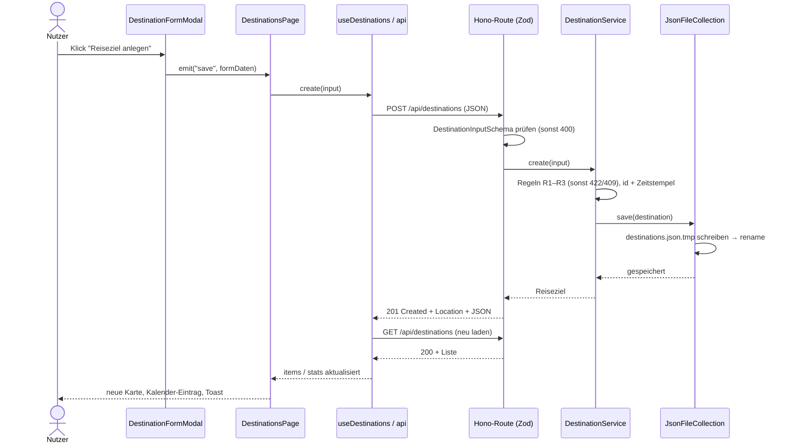

# Fernweh – Reiseziele verwalten

Prüfungsprojekt T4 „Entwicklung von Webanwendungen mit entkoppelter Architektur“ (DHBW Mosbach, ON25:T4).

**Problem:** Reiseideen liegen verstreut in Notizen, Screenshots und Lesezeichen. **Zielgruppe:** Menschen, die
gern reisen und ihre Wunsch-, geplanten und besuchten Ziele an einem Ort sammeln wollen.
**Kernfunktion:** Reiseziele **anlegen, anzeigen, bearbeiten und löschen**. Ein Reiseziel besteht aus Name, Land,
Kontinent, Notizen, Status (Wunschziel / geplant / besucht), Reisedatum, einer Bewertung von 1–5 und optional einem
Bild. Ziele lassen sich filtern, durchsuchen, sortieren, als „besucht“ markieren und bewerten. Ein **Reisekalender**
zeigt, wann Reisen geplant sind.

## Architektur



**Entkoppelt:** Das Frontend kennt nur den REST-Vertrag (URLs, JSON-Formate, Statuscodes, Fehlerformat) und die
Basis-URL aus `VITE_API_URL`. Es weiß nichts von Hono, Zod oder JSON-Dateien. Ein anderer Client (mobile App,
`curl`) kann dieselbe API nutzen; Geschäftsregeln und Validierung gelten trotzdem, weil sie im Backend liegen.
Beispiel: Der **Reisekalender** brauchte keine neue API – das Frontend stellt vorhandene Daten (`travelDate`)
nur anders dar.

---

## Schnellstart

Voraussetzungen: [Deno 2](https://deno.com) und Node.js ≥ 20.

```bash
# 1) Backend (Port 8000)
cd backend
cp .env.example .env
deno task dev     # legt beim ersten Start data/destinations.json aus data/seed.json an

# 2) Frontend (Port 5173) – zweites Terminal
cd frontend
cp .env.example .env.local
npm install
npm run dev       # in Windows PowerShell: npm.cmd run dev
```

Dann <http://localhost:5173> öffnen. Zurücksetzen auf die Beispieldaten: Backend stoppen,
`backend/data/destinations.json` löschen, Backend neu starten.

| Befehl                      | Zweck                                         |
| --------------------------- | --------------------------------------------- |
| `deno task test` (backend)  | 15 API-Tests (CRUD, Validierung, Regeln, Persistenz) |
| `deno task check` (backend) | Typprüfung                                    |
| `npm run build` (frontend)  | Typprüfung mit `vue-tsc` + Produktions-Build  |

### HTTPS (optional, vgl. Vorlesung „Von http zu https“)

```bash
mkcert -install
mkdir backend/certs && cd backend/certs && mkcert -key-file localhost-key.pem -cert-file localhost.pem localhost 127.0.0.1
```

`backend/.env`: `USE_HTTPS=true` → Server startet per TLS und setzt den HSTS-Header. Fehlen die Zertifikate, bricht
der Start ab – **kein stiller Rückfall auf HTTP**. `frontend/.env.local`: `VITE_HTTPS=true`,
`VITE_API_URL=https://localhost:8000` (sonst blockiert der Browser die API als *Mixed Content*).
Zertifikate und `.env`-Dateien sind per `.gitignore` ausgeschlossen.

---

## Projektstruktur

```
backend/
  main.ts                          Einstieg: .env lesen, nur 127.0.0.1, Seed, HTTP/HTTPS
  src/app.ts                       Hono-App: Logger, CORS, HSTS, zentrale Fehlerbehandlung
  src/routes/destinations.ts       REST-Controller, Zod-Validierung
  src/services/destinationService.ts  Geschäftsregeln R1–R4, Filter, Sortierung
  src/repository/jsonFileCollection.ts  Collection-Interface, JSON-Datei- und In-Memory-Speicher
  src/models/destination.ts        Zod-Schemas = Datenmodell + Validierung
  src/validation.ts, src/errors.ts Zod → 400, ApiError → einheitliches Fehlerformat
  data/seed.json                   Beispieldaten
  tests/api_test.ts                Tests gegen die echte Hono-App (In-Memory-Speicher)

frontend/src/
  App.vue                          Wurzel, zeigt DestinationsPage
  api/client.ts                    fetch-Wrapper, Fehlerformat → ApiRequestError
  api/destinations.ts              alle REST-Aufrufe
  composables/useDestinations.ts   Server State: Liste, Filter, Kennzahlen, CRUD
  composables/useToasts.ts         Benachrichtigungen
  types/destination.ts             Typen des REST-Vertrags + deutsche Labels
  components/                      DestinationsPage, HeroSection, InsightsBento, TripCalendar, FilterBar,
                                   DestinationCard, DestinationFormModal, DestinationDetailModal,
                                   ConfirmDialog, BaseModal, RatingInput, ToastStack, AppFooter
  styles/main.scss                 Bootstrap-Variablen (Sass) + Design-Tokens
```

**Wo liegt der Zustand?** Server State (Reiseziele, Kennzahlen) in `useDestinations`; UI State (welches Modal
offen ist, angezeigter Kalendermonat, Formularinhalt) lokal in der jeweiligen Komponente. Daten fließen über
Props nach unten und Events nach oben; nur das Composable spricht mit der API.

---

## Datenmodell

Eine Entität: **Destination** (Reiseziel).

| Feld               | Typ                                          | Regeln                                  |
| ------------------ | -------------------------------------------- | --------------------------------------- |
| `id`               | string (UUID)                                | vom Server vergeben                     |
| `name`, `country`  | string                                       | Pflicht, 1–80 / 1–60 Zeichen            |
| `continent`        | `AFRICA` `ANTARCTICA` `ASIA` `EUROPE` `NORTH_AMERICA` `OCEANIA` `SOUTH_AMERICA` | Pflicht |
| `notes`            | string                                       | max. 1000 Zeichen, Default `""`        |
| `status`           | `WISHLIST` `PLANNED` `VISITED`               | Pflicht                                 |
| `travelDate`       | `YYYY-MM-DD` \| null                         | gültiges Kalenderdatum (Basis für den Kalender) |
| `rating`           | 1–5 \| null                                  | ganzzahlig                              |
| `imageUrl`         | string \| null                               | nur `https://`                          |
| `createdAt`, `updatedAt` | ISO-Zeitstempel                        | vom Server gesetzt                      |

### Geschäftsregeln (im `DestinationService`)

| Regel | Beschreibung                                                               | Antwort |
| ----- | -------------------------------------------------------------------------- | ------- |
| R1    | Bewertung nur für Ziele mit Status `VISITED`.                              | 422     |
| R2    | Ein besuchtes Ziel kann kein Reisedatum in der Zukunft haben.              | 422     |
| R3    | Name + Land sind eindeutig (ohne Groß-/Kleinschreibung).                   | 409     |
| R4    | Wechselt ein Ziel per PATCH weg von `VISITED`, wird die Bewertung entfernt. | –      |

---

## Warum keine Anmeldung?

Fernweh ist bewusst eine **persönliche Single-User-Anwendung**: ein Reisetagebuch für eine Person auf dem eigenen
Rechner. Die Prüfungsvorgabe verlangt ausdrücklich **kein** komplexes Login-System („klein, vollständig“).

- **Kein Nutzen:** Es gibt nur eine Person und nur ihre Daten – nichts, was zwischen Nutzern getrennt werden müsste.
- **Weniger Angriffsfläche und Komplexität:** keine Passwörter, die gespeichert und geschützt werden müssen, keine
  Sessions, kein CSRF-Thema.
- **Trotzdem geschützt:** Der Server lauscht nur auf **127.0.0.1** (`HOST` in `.env`, siehe `main.ts`). Er ist
  damit nur vom eigenen Rechner erreichbar, nicht aus dem WLAN oder Internet. CORS erlaubt nur `http://localhost:5173`.

**Wenn mehrere Personen die App nutzen sollen** (Neubewertung von ADR-003), wäre der Weg:
Registrierung/Login mit Passwort-Hash (z. B. PBKDF2 oder Argon2 mit Salt), serverseitige **Session** mit Token im
**HttpOnly-, SameSite-Cookie**, eine Middleware, die vor jeder Route die Session prüft (sonst 401), und ein Feld
`ownerId` an jedem Reiseziel, das der Service bei jedem Zugriff mit der Nutzer-ID aus der Session vergleicht
(fremde Daten → 404). Dafür müssten nur Backend-Schichten ergänzt werden; die Entkopplung bleibt.

---

## REST-API

Basis-URL: `http://localhost:8000/api` · alle Bodies JSON

| Methode  | Pfad                 | Beschreibung                       | Erfolg                  | typische Fehler |
| -------- | -------------------- | ---------------------------------- | ----------------------- | --------------- |
| `GET`    | `/destinations`      | Liste (Filter, Suche, Sortierung)  | 200 + Array             | 400             |
| `GET`    | `/destinations/{id}` | einzelnes Reiseziel                | 200                     | 404             |
| `POST`   | `/destinations`      | anlegen                            | 201 + `Location`-Header | 400, 409, 422   |
| `PUT`    | `/destinations/{id}` | vollständig ersetzen (Formular)    | 200                     | 400, 404, 409, 422 |
| `PATCH`  | `/destinations/{id}` | Teil-Update (Status, Bewertung)    | 200                     | 400, 404, 422   |
| `DELETE` | `/destinations/{id}` | löschen                            | 204                     | 404             |
| `GET`    | `/health`            | Lebenszeichen                      | 200                     | –               |

Query-Parameter für `GET /destinations`: `status`, `continent`, `q` (Suche in Name/Land/Notizen),
`sort` = `createdAt` (Default) | `name` | `travelDate` | `rating`.

### Beispiel

```http
POST /api/destinations
Content-Type: application/json

{ "name": "Lissabon", "country": "Portugal", "continent": "EUROPE", "status": "PLANNED", "travelDate": "2027-05-10" }
```

```http
HTTP/1.1 201 Created
Location: /api/destinations/3f1c…

{ "id": "3f1c…", "name": "Lissabon", "country": "Portugal", "continent": "EUROPE", "notes": "",
  "status": "PLANNED", "travelDate": "2027-05-10", "rating": null, "imageUrl": null,
  "createdAt": "2026-11-14T10:00:00.000Z", "updatedAt": "2026-11-14T10:00:00.000Z" }
```

### Fehlerformat (für alle Fehler gleich)

```json
{ "error": { "code": "VALIDATION_ERROR", "message": "Die Anfrage enthält ungültige Daten",
             "details": [{ "field": "name", "message": "Name ist erforderlich" }] } }
```

| Status | `code`                    | Wann                                                    |
| ------ | ------------------------- | ------------------------------------------------------- |
| 400    | `VALIDATION_ERROR`        | ungültiges JSON, fehlende/falsche/unbekannte Felder     |
| 404    | `NOT_FOUND`               | ID oder Route existiert nicht                           |
| 409    | `CONFLICT`                | Duplikat (R3)                                           |
| 422    | `BUSINESS_RULE_VIOLATION` | R1, R2                                                  |
| 500    | `INTERNAL_ERROR`          | unerwarteter Fehler (Details nur im Server-Log)         |

### Validierung – wo und warum

| Ebene    | Was                                                     | Warum                                            |
| -------- | ------------------------------------------------------- | ------------------------------------------------ |
| Frontend | `maxlength`, Input-Typen, Sterne deaktiviert, wenn nicht besucht | schnelle Rückmeldung, Bedienkomfort      |
| Backend – Zod | Typen, Pflichtfelder, Längen, Enums, Datum, HTTPS-URL, keine unbekannten Felder | **verbindlich**: Requests können am Frontend vorbei geschickt werden (curl, DevTools) |
| Backend – Service | Geschäftsregeln R1–R4, Eindeutigkeit           | fachliche Regeln brauchen den gespeicherten Zustand |

---

## Reisekalender

`TripCalendar.vue` zeigt eine **Monatsansicht** (Mo–So). Jedes Reiseziel mit `travelDate` erscheint an seinem Tag,
farbig nach Status (geplant = Lime, besucht = Blau, Wunschziel = Gelb); ein Klick öffnet die Details.
Darüber zeigt eine **Monatsleiste**, in welchen Monaten des Jahres Reisen liegen. Rechts listet **„Nächste Reisen“**
die kommenden geplanten Reisen mit Countdown; ein Klick springt zum passenden Monat.
Die Komponente bekommt dieselben Daten wie die Karten (`useDestinations().all`) – **keine zusätzliche API**.

---

## Ablauf: „Was passiert beim Klick auf Speichern?“



Fehlerfall: Liefert der Server 400/409/422, wirft `api/client.ts` einen `ApiRequestError` mit `fieldErrors`;
das Formular bleibt offen und zeigt die Meldung direkt am Feld.

---

## Architekturentscheidungen (ADRs, Kurzform)

**ADR-001 – Backend mit Deno + Hono statt Java/Quarkus.**
Eine Sprache (TypeScript) in Front- und Backend, kein Build-Schritt, Hono basiert auf Web-Standards
(`Request`/`Response`), `app.request()` erlaubt Tests ohne laufenden Server. Konsequenz: kleineres Ökosystem;
Schichten selbst strukturiert (Konstruktor-Injection in `createApp`).

**ADR-002 – Persistenz als JSON-Datei hinter einem Collection-Interface** (verworfen: SQLite, Deno KV).
Eine Entität, eine Person, wenige Daten – Architektur bleibt sichtbar, keine Zusatz-Infrastruktur. Schreiben
serialisiert und atomar (temp + rename). Konsequenz: keine Transaktionen, keine Indizes, Filtern im Speicher.
Austausch gegen SQLite betrifft nur `JsonFileCollection`, nicht Service oder API.

**ADR-003 – Keine Anmeldung: Single-User, Server nur auf 127.0.0.1** (verworfen: Login mit Sessions/Cookies).
Siehe „Warum keine Anmeldung?“. Konsequenz: Wer Zugriff auf den Rechner hat, sieht die Daten; Mehrbenutzerbetrieb
oder Hosting im Internet erfordern eine Neubewertung (Login, Sessions, `ownerId`).

**ADR-004 – Reisekalender als reine Frontend-Ansicht** (verworfen: eigener Endpunkt `/api/calendar`).
`travelDate` ist bereits in der Liste enthalten; ein eigener Endpunkt würde dieselben Daten doppelt liefern.
Konsequenz: Bei sehr vielen Reisen würde man die Liste per Query (`?from=&to=`) auf einen Monat einschränken.

**ADR-005 – Validierung mit Zod im Backend, Geschäftsregeln im Service.**
Zod-Schemas sind zugleich Typquelle; `strict()` lehnt unbekannte Felder ab. Trennung 400 (Form falsch) vs.
422/409 (fachlich unzulässig). Das Frontend validiert nur zur Bequemlichkeit.

**ADR-006 – PUT für das Formular, PATCH für Schnellaktionen.**
Formular kennt alle Felder → PUT (idempotent). Statuswechsel/Bewertung in der Detailansicht → PATCH mit einem Feld.

**ADR-007 – Kein Vue Router, kein Pinia; Composables.**
Eine Seite, ein Anwendungsfall. `useDestinations` reicht als zentraler Zustand.

**ADR-008 – Bootstrap 5 über Sass, Modals ohne Bootstrap-JS; Schriften selbst gehostet.**
Layout aus Bootstrap, Design über Sass-Variablen. Modal-Zustand liegt in Vue (eine Quelle der Wahrheit).
Schriften über `@fontsource` → keine Requests an Google (DSGVO).

---

## Bekannte Schwächen / was ich anders machen würde

- **Keine Anmeldung** – bewusst, aber dadurch nur für eine Person auf einem Rechner geeignet.
- **JSON-Datei** skaliert nicht (alles im Speicher gefiltert, keine Transaktionen) → SQLite.
- Eine Reise hat nur **ein Datum**, keine Dauer (Start–Ende) – der Kalender zeigt nur den Abreisetag.
- Bilder nur als externe URL (Hotlinking), kein Upload.
- Keine Frontend-Tests (nur API-Tests).

**Abweichungen vom Entwurf (Moodle-Abgabe „Themenwahl“):** zusätzliches Feld `imageUrl` (nur HTTPS) für die
Karten-Darstellung und ein Reisekalender als zusätzliche Ansicht.

---

## Design

Angelehnt an das Behance-Projekt *„Locally – Local Travel Platform“*: Palette Chartreuse `#C8FF32`, Electric
Sapphire `#586EFF`, Walking on Sunshine `#FFFFA0`, Blushed Brick `#BC4749`; große Versal-Headlines, Pill-Buttons,
Bento-Kacheln, Foto-Karten mit großem Radius. Ersatzschriften: **Unbounded** (Display), **Outfit** (Text).
Beispielbilder: Unsplash.

## Projekthistorie (Git)

1. **14.11.2026** – erste vollständige Version: Reiseziele-CRUD mit Anmeldung, Vortragsfolien und Dokumentation.
2. **18.11.2026** – aktueller Stand: Reisekalender ergänzt, Anmeldung entfernt (Single-User, Server nur auf
   127.0.0.1), Vortragsunterlagen aus dem Code-Repository ausgelagert, Abschnitt zur KI-Nutzung überarbeitet.

**Hinweis:** Zwischen diesen beiden Ständen gab es zwei weitere Commits („Sprechtext für den Vortrag“ und
„Reisekalender ergänzt, Anmeldung entfernt“). Sie sind beim Umbau des Repositorys verloren gegangen; ihre Änderungen
sind im zweiten Commit enthalten. Es gibt nur den Zweig `main`.

## Quellen und KI-Nutzung

Vue.js-, Hono-, Deno-, Zod- und Bootstrap-Dokumentation, MDN Web Docs, Vorlesungsunterlagen T4 (Dr. A. Mester).

**KI-Unterstützung:** Bei der Programmierung habe ich Claude (Anthropic) als Hilfsmittel eingesetzt. Ein großer
Teil des Codes, der Tests und der Dokumentation ist mit dieser Unterstützung entstanden.

**Eigene Leistung:**

- **Design:** Gestaltungskonzept, Auswahl der Vorlage „Locally“, Farbwelt und mein eigenes Foto als Hero-Bild
- **Inhalt:** Thema, Anforderungen und Datenmodell (Moodle-Abgabe „Themenwahl“)
- **Entscheidungen:** Reisekalender als zusätzliche Funktion, bewusst keine Anmeldung
- **Prüfung:** Ich habe die Anwendung getestet und mir Aufbau, Datenfluss und Entscheidungen erarbeitet, sodass
  ich sie erklären kann.
