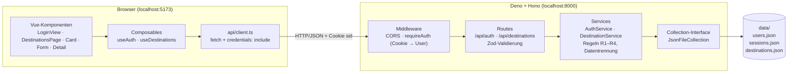
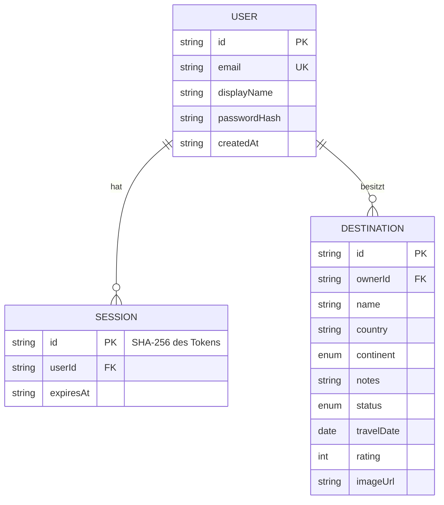
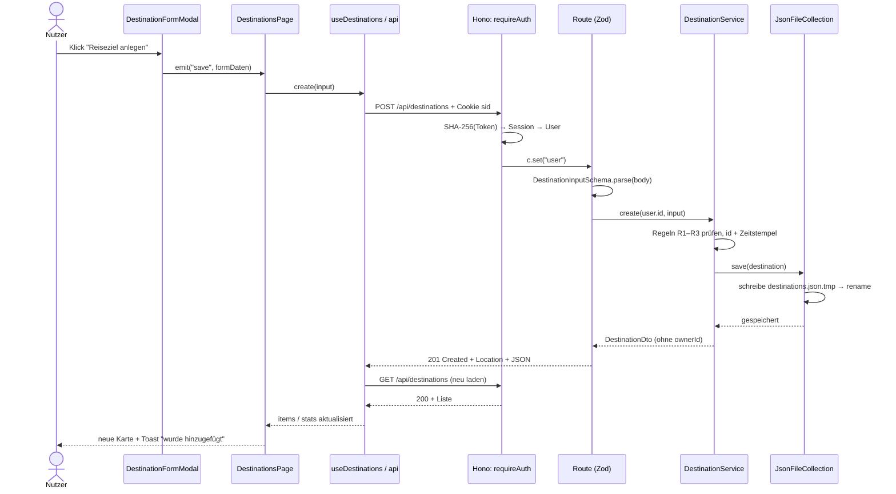

# Fernweh – Reiseziele verwalten

Prüfungsprojekt T4 „Entwicklung von Webanwendungen mit entkoppelter Architektur“ (DHBW Mosbach, ON25:T4).

**Problem:** Reiseideen liegen verstreut in Notizen, Screenshots und Lesezeichen. **Zielgruppe:** Menschen, die
gern reisen und ihre Wunsch-, geplanten und besuchten Ziele an einem Ort sammeln wollen.
**Kernfunktion:** Nutzer melden sich an und können ihre eigenen **Reiseziele anlegen, anzeigen, bearbeiten und
löschen**. Ein Reiseziel besteht aus Name, Land, Kontinent, Notizen, Status (Wunschziel / geplant / besucht),
Reisedatum, einer Bewertung von 1–5 und optional einem Bild. Ziele lassen sich filtern, durchsuchen, sortieren,
als „besucht“ markieren und bewerten. Jeder Nutzer sieht ausschließlich seine eigenen Daten.

**Prüfung:** Folien `docs/vortrag/Fernweh-Folien-Alina-Pabst.pdf` (Quelle: `folien.html`) ·
Demo-Ablauf `docs/demo-skript.md` · Gesprächsvorbereitung `docs/pruefungsvorbereitung.md`

## Architektur



**Entkoppelt:** Das Frontend kennt nur den REST-Vertrag (URLs, JSON-Formate, Statuscodes, Fehlerformat) und
die Basis-URL aus `VITE_API_URL`. Es weiß nichts von Hono, Zod oder JSON-Dateien. Ein anderer Client (z. B. eine
mobile App oder `curl`) kann dieselbe API nutzen; Geschäftsregeln, Validierung und Datentrennung gelten trotzdem,
weil sie im Backend liegen.

---

## Schnellstart

Voraussetzungen: [Deno 2](https://deno.com) und Node.js ≥ 20.

```bash
# 1) Backend (Port 8000)
cd backend
cp .env.example .env
deno task dev     # legt beim ersten Start Demo-Nutzer + Beispieldaten aus data/seed.json an

# 2) Frontend (Port 5173) – zweites Terminal
cd frontend
cp .env.example .env.local
npm install
npm run dev
```

Dann <http://localhost:5173> öffnen. **Demo-Konten** (in `backend/data/seed.json`):

| E-Mail              | Passwort            | Daten                                  |
| ------------------- | ------------------- | -------------------------------------- |
| `lena@fernweh.test` | `Fernweh-Demo-2026` | 6 Reiseziele (Tokio, Venedig, Bali, …) |
| `max@fernweh.test`  | `Fernweh-Demo-2026` | 2 Reiseziele (Reykjavík, Rio)          |

Zurücksetzen auf die Demo-Daten: Backend stoppen, `backend/data/users.json`, `sessions.json` und
`destinations.json` löschen, Backend neu starten.

| Befehl                     | Zweck                                         |
| -------------------------- | --------------------------------------------- |
| `deno task test` (backend) | 17 API-Tests (Auth, Datentrennung, CRUD, Regeln) |
| `deno task check` (backend) | Typprüfung                                   |
| `npm run build` (frontend) | Typprüfung mit `vue-tsc` + Produktions-Build  |

### HTTPS (optional, vgl. Vorlesung „Von http zu https“)

```bash
mkcert -install
mkdir backend/certs && cd backend/certs && mkcert -key-file localhost-key.pem -cert-file localhost.pem localhost 127.0.0.1
```

`backend/.env`: `USE_HTTPS=true` → Server startet per TLS, setzt HSTS und das Cookie mit `Secure`. Fehlen die
Zertifikate, bricht der Start ab – **kein stiller Rückfall auf HTTP**. `frontend/.env.local`: `VITE_HTTPS=true`,
`VITE_API_URL=https://localhost:8000` (sonst blockiert der Browser die API als *Mixed Content*).
Zertifikate und `.env`-Dateien sind per `.gitignore` ausgeschlossen.

---

## Projektstruktur

```
backend/
  main.ts                          Einstieg: .env lesen, Abhängigkeiten verdrahten, Seed, HTTP/HTTPS
  src/app.ts                       Hono-App: CORS (mit Credentials), HSTS, Auth-Middleware, Fehlerbehandlung
  src/auth.ts                      Session-Cookie setzen/löschen, Middleware requireAuth
  src/routes/auth.ts               POST register/login/logout, GET me
  src/routes/destinations.ts       CRUD-Controller, userId aus der Session
  src/services/authService.ts      Registrierung, Login, Sessions (Ablauf 7 Tage)
  src/services/crypto.ts           PBKDF2-Passwort-Hash, Session-Token, SHA-256
  src/services/destinationService.ts  Geschäftsregeln R1–R4, Filter, Datentrennung
  src/repository/jsonFileCollection.ts  Collection-Interface, JSON-Datei- und In-Memory-Implementierung
  src/models/*.ts                  Zod-Schemas + Typen (Destination, User, Session)
  src/validation.ts, src/errors.ts Zod → 400, ApiError → einheitliches Fehlerformat
  src/seed.ts, data/seed.json      Demo-Nutzer und Beispieldaten
  tests/api_test.ts                Tests gegen die echte Hono-App (In-Memory-Speicher)

frontend/src/
  App.vue                          Login oder Hauptseite (je nach Session)
  api/client.ts                    fetch-Wrapper: Cookies mitsenden, Fehlerformat → ApiRequestError, 401 → Login
  api/auth.ts, api/destinations.ts alle REST-Aufrufe
  composables/useAuth.ts           Anmeldezustand (wer ist angemeldet?)
  composables/useDestinations.ts   Server State: Liste, Filter, Kennzahlen, CRUD
  composables/useToasts.ts         Benachrichtigungen
  types/destination.ts             Typen des REST-Vertrags + deutsche Labels
  components/                      LoginView, DestinationsPage, HeroSection, InsightsBento, FilterBar,
                                   DestinationCard, DestinationFormModal, DestinationDetailModal,
                                   ConfirmDialog, BaseModal, RatingInput, ToastStack, AppFooter
  styles/main.scss                 Bootstrap-Variablen (Sass) + Design-Tokens
```

**Wo liegt der Zustand?** Server State (Reiseziele, Kennzahlen) in `useDestinations`, Anmeldezustand in `useAuth`,
UI State (welches Modal offen ist, Formularinhalt) lokal in `DestinationsPage` bzw. in der jeweiligen Komponente.
Komponenten kommunizieren über Props nach unten und Events nach oben; nur die Composables sprechen mit der API.

---

## Datenmodell



| Feld (Destination) | Typ                                         | Regeln                                  |
| ------------------ | ------------------------------------------- | --------------------------------------- |
| `name`, `country`  | string                                      | Pflicht, 1–80 / 1–60 Zeichen            |
| `continent`        | `AFRICA` `ANTARCTICA` `ASIA` `EUROPE` `NORTH_AMERICA` `OCEANIA` `SOUTH_AMERICA` | Pflicht |
| `notes`            | string                                      | max. 1000 Zeichen, Default `""`        |
| `status`           | `WISHLIST` `PLANNED` `VISITED`              | Pflicht                                 |
| `travelDate`       | `YYYY-MM-DD` \| null                        | gültiges Kalenderdatum                  |
| `rating`           | 1–5 \| null                                 | ganzzahlig                              |
| `imageUrl`         | string \| null                              | nur `https://`                          |
| `id`, `ownerId`, `createdAt`, `updatedAt` | – | vom Server gesetzt; `ownerId` wird nie ausgeliefert |

### Geschäftsregeln (im `DestinationService`)

| Regel | Beschreibung                                                               | Antwort |
| ----- | -------------------------------------------------------------------------- | ------- |
| R1    | Bewertung nur für Ziele mit Status `VISITED`.                              | 422     |
| R2    | Ein besuchtes Ziel kann kein Reisedatum in der Zukunft haben.              | 422     |
| R3    | Name + Land sind pro Nutzer eindeutig (ohne Groß-/Kleinschreibung).        | 409     |
| R4    | Wechselt ein Ziel per PATCH weg von `VISITED`, wird die Bewertung entfernt. | –      |

---

## Anmeldung, Session, Cookie

**Passwörter** werden nie gespeichert, sondern mit **PBKDF2-HMAC-SHA256** (Web Crypto API, 600 000 Iterationen,
16 Byte zufälliges Salt pro Nutzer) gehasht: `pbkdf2-sha256$600000$<salt>$<hash>`. Das Salt verhindert, dass
gleiche Passwörter gleiche Hashes ergeben (Rainbow Tables); die vielen Iterationen machen jeden Rateversuch teuer,
falls die Datei gestohlen wird. Verglichen wird in konstanter Zeit.

**Session:** Nach erfolgreichem Login erzeugt der Server ein zufälliges 256-Bit-Token. Gespeichert wird nur
`SHA-256(Token)` mit `userId` und Ablaufzeit (7 Tage) in `sessions.json`. Das Token selbst geht einmal als Cookie
an den Browser:

```
Set-Cookie: sid=<token>; Max-Age=604800; Path=/; HttpOnly; SameSite=Lax   (+ Secure bei HTTPS)
```

- `HttpOnly` – JavaScript kann das Cookie nicht lesen → ein XSS-Angriff kann das Token nicht stehlen.
- `SameSite=Lax` – fremde Websites können keine POST/PUT/DELETE-Requests mit diesem Cookie auslösen (CSRF).
  Zusätzlich verlangt die API JSON (`Content-Type: application/json` → CORS-Preflight), und CORS erlaubt nur
  `http://localhost:5173` mit `credentials: true`.
- Frontend (`:5173`) und Backend (`:8000`) sind *same-site* (gleicher Host), daher wird das Cookie mit
  `fetch(..., { credentials: "include" })` mitgeschickt.

Bei jedem Request liest die Middleware `requireAuth` das Cookie, sucht die Session, prüft den Ablauf und legt den
Nutzer in `c.get("user")` ab. Ohne gültige Session → `401 UNAUTHORIZED`; das Frontend zeigt dann die Login-Seite.
**Logout** löscht die Session serverseitig und das Cookie im Browser.

**Login-Fehler** sind absichtlich unspezifisch („E-Mail oder Passwort ist falsch“); auch bei unbekannter E-Mail wird
ein Hash berechnet, damit die Antwortzeit nicht verrät, ob ein Konto existiert.

### Datentrennung zwischen Nutzern

- Die `userId` stammt **ausschließlich aus der Session**, nie aus URL oder Body (`ownerId` im Body → 400, da Schema `strict`).
- Jede Methode im `DestinationService` filtert bzw. prüft `ownerId === userId`.
- Fremde Reiseziele verhalten sich wie nicht vorhandene → **404** (nicht 403), damit fremde IDs nicht erkennbar sind.
- Abgesichert durch den Test „Datentrennung: Nutzer B sieht, ändert und löscht keine Daten von A“.

---

## REST-API

Basis-URL: `http://localhost:8000/api` · alle Bodies JSON · 🔒 = Session-Cookie erforderlich

| Methode  | Pfad                    | Beschreibung                            | Erfolg                         | typische Fehler |
| -------- | ----------------------- | --------------------------------------- | ------------------------------ | --------------- |
| `POST`   | `/auth/register`        | Konto anlegen + anmelden                | 201 + `Set-Cookie`             | 400, 409        |
| `POST`   | `/auth/login`           | anmelden                                | 200 + `Set-Cookie`             | 400, 401        |
| `POST`   | `/auth/logout`          | abmelden                                | 204                            | –               |
| `GET`    | `/auth/me` 🔒           | angemeldeter Nutzer                     | 200                            | 401             |
| `GET`    | `/destinations` 🔒      | eigene Liste (Filter, Suche, Sortierung) | 200 + Array                   | 400, 401        |
| `GET`    | `/destinations/{id}` 🔒 | einzelnes Reiseziel                     | 200                            | 401, 404        |
| `POST`   | `/destinations` 🔒      | anlegen                                 | 201 + `Location`-Header        | 400, 401, 409, 422 |
| `PUT`    | `/destinations/{id}` 🔒 | vollständig ersetzen (Formular)         | 200                            | 400, 401, 404, 409, 422 |
| `PATCH`  | `/destinations/{id}` 🔒 | Teil-Update (Status, Bewertung)         | 200                            | 400, 401, 404, 422 |
| `DELETE` | `/destinations/{id}` 🔒 | löschen                                 | 204                            | 401, 404        |
| `GET`    | `/health`               | Lebenszeichen                           | 200                            | –               |

Query-Parameter für `GET /destinations`: `status`, `continent`, `q` (Suche in Name/Land/Notizen),
`sort` = `createdAt` (Default) | `name` | `travelDate` | `rating`.

### Beispiel

```http
POST /api/destinations
Content-Type: application/json
Cookie: sid=…

{ "name": "Lissabon", "country": "Portugal", "continent": "EUROPE", "status": "WISHLIST" }
```

```http
HTTP/1.1 201 Created
Location: /api/destinations/3f1c…

{ "id": "3f1c…", "name": "Lissabon", "country": "Portugal", "continent": "EUROPE", "notes": "",
  "status": "WISHLIST", "travelDate": null, "rating": null, "imageUrl": null,
  "createdAt": "2026-11-12T10:00:00.000Z", "updatedAt": "2026-11-12T10:00:00.000Z" }
```

### Fehlerformat (für alle Fehler gleich)

```json
{ "error": { "code": "VALIDATION_ERROR", "message": "Die Anfrage enthält ungültige Daten",
             "details": [{ "field": "name", "message": "Name ist erforderlich" }] } }
```

| Status | `code`                    | Wann                                                        |
| ------ | ------------------------- | ----------------------------------------------------------- |
| 400    | `VALIDATION_ERROR`        | ungültiges JSON, fehlende/falsche/unbekannte Felder         |
| 401    | `UNAUTHORIZED`            | keine oder abgelaufene Session                              |
| 401    | `INVALID_CREDENTIALS`     | Login fehlgeschlagen                                        |
| 404    | `NOT_FOUND`               | ID existiert nicht **oder gehört einem anderen Nutzer**; unbekannte Route |
| 409    | `CONFLICT`                | Duplikat (R3, E-Mail schon registriert)                     |
| 422    | `BUSINESS_RULE_VIOLATION` | R1, R2                                                      |
| 500    | `INTERNAL_ERROR`          | unerwarteter Fehler (Details nur im Server-Log)             |

### Validierung – wo und warum

| Ebene    | Was                                                     | Warum                                            |
| -------- | ------------------------------------------------------- | ------------------------------------------------ |
| Frontend | `maxlength`, `type="email"/"url"/"date"`, Sterne deaktiviert, wenn nicht besucht | schnelle Rückmeldung, Bedienkomfort |
| Backend – Zod | Typen, Pflichtfelder, Längen, Enums, Datum, HTTPS-URL, keine unbekannten Felder | **verbindlich**: Requests können am Frontend vorbei geschickt werden (curl, DevTools) |
| Backend – Service | Geschäftsregeln R1–R4, Eindeutigkeit, Besitz        | fachliche Regeln brauchen den gespeicherten Zustand |

---

## Ablauf: „Was passiert beim Klick auf Speichern?“



Fehlerfall: Liefert der Server 400/409/422, wirft `api/client.ts` einen `ApiRequestError` mit `fieldErrors`;
das Formular bleibt offen und zeigt die Meldung direkt am Feld. Bei 401 springt die App zur Login-Seite.

---

## Architekturentscheidungen (ADRs, Kurzform)

**ADR-001 – Backend mit Deno + Hono statt Java/Quarkus.**
Kontext: Wahl laut Prüfungsvorgabe. Entscheidung: Deno + Hono. Begründung: eine Sprache (TypeScript) in Front- und
Backend, kein Build-Schritt, Hono basiert auf Web-Standards (`Request`/`Response`), `app.request()` erlaubt Tests ohne
laufenden Server. Konsequenz: kleineres Ökosystem; Schichten und Dependency Injection selbst strukturiert
(Konstruktor-Injection in `createApp`).

**ADR-002 – Persistenz als JSON-Dateien hinter einem Collection-Interface** (verworfen: SQLite, Deno KV).
Begründung: drei kleine Sammlungen, wenige Nutzer; Architektur bleibt sichtbar, keine Zusatz-Infrastruktur.
Schreibzugriffe werden serialisiert und atomar (temp + rename) geschrieben. Konsequenz: keine Transaktionen über
mehrere Dateien, keine Indizes, Filtern im Speicher – bei vielen Nutzern ungeeignet. Austausch gegen SQLite betrifft
nur `JsonFileCollection`, nicht Services oder API.

**ADR-003 – Serverseitige Sessions mit HttpOnly-Cookie statt JWT im localStorage.**
Alternative: JWT im `localStorage` + `Authorization`-Header. Verworfen, weil (1) ein Token im `localStorage` per XSS
auslesbar ist, (2) ein JWT vor Ablauf nicht widerrufen werden kann (Logout nur clientseitig). Mit Sessions kann der
Server sofort abmelden; das Cookie ist für JavaScript unsichtbar. Konsequenz: Server muss Sessions speichern
(`sessions.json`); CSRF muss bedacht werden → `SameSite=Lax`, JSON-only, enges CORS.

**ADR-004 – Passwort-Hashing mit PBKDF2 (Web Crypto) statt bcrypt/Argon2-Bibliothek.**
Argon2id wäre das modernere Verfahren, braucht in Deno aber eine native/WASM-Fremdbibliothek. PBKDF2-SHA256 ist in
der Plattform eingebaut, von NIST/OWASP akzeptiert (≥ 600 000 Iterationen) und ohne Abhängigkeit nachvollziehbar.
Das Format speichert die Iterationszahl → später erhöhbar.

**ADR-005 – Validierung mit Zod im Backend, Geschäftsregeln im Service.**
Zod-Schemas sind zugleich Typquelle; `strict()` lehnt unbekannte Felder (z. B. `ownerId`) ab. Trennung 400 (Form
falsch) vs. 422/409 (fachlich unzulässig). Das Frontend validiert nur zur Bequemlichkeit.

**ADR-006 – PUT für das Formular, PATCH für Schnellaktionen.**
Formular kennt alle Felder → PUT (idempotent). Statuswechsel/Bewertung in der Detailansicht → PATCH mit einem Feld.

**ADR-007 – Kein Vue Router, kein Pinia; Composables.**
Ein Anwendungsfall, eine Seite + Login. `useAuth`/`useDestinations` reichen als zentraler Zustand. Neu bewerten,
wenn weitere Seiten oder deutlich mehr geteilter Zustand hinzukommen.

**ADR-008 – Bootstrap 5 über Sass, Modals ohne Bootstrap-JS; Schriften selbst gehostet.**
Layout/Responsiveness aus Bootstrap, Design über Sass-Variablen. Modal-Zustand liegt in Vue (eine Quelle der
Wahrheit). Schriften über `@fontsource` → keine Requests an Google (DSGVO).

---

## Bekannte Schwächen / was ich anders machen würde

- **Kein Rate-Limiting beim Login** → Brute-Force nur durch PBKDF2-Kosten gebremst. Nächster Schritt: Fehlversuche pro IP/E-Mail zählen.
- **JSON-Dateien** skalieren nicht (jede Anfrage filtert alle Daten im Speicher, keine Transaktionen) → SQLite.
- Abgelaufene Sessions werden erst beim nächsten Zugriff gelöscht, nicht periodisch aufgeräumt.
- Keine Passwort-Zurücksetzen-Funktion, keine E-Mail-Bestätigung.
- Bilder nur als externe URL (Hotlinking), kein Upload.
- Keine Frontend-Tests (nur API-Tests).

**Abweichungen vom Entwurf (Moodle-Abgabe „Themenwahl“):** zusätzliches Feld `imageUrl` (nur HTTPS, für die
Karten-Darstellung); Benutzerkonten mit Anmeldung und Datentrennung, damit mehrere Personen die App nutzen können.

---

## Design

Angelehnt an das Behance-Projekt *„Locally – Local Travel Platform“*: Palette Chartreuse `#C8FF32`, Electric
Sapphire `#586EFF`, Walking on Sunshine `#FFFFA0`, Blushed Brick `#BC4749`; große Versal-Headlines, Pill-Buttons,
Bento-Kacheln, Foto-Karten mit großem Radius. Ersatzschriften: **Unbounded** (Display), **Outfit** (Text).
Beispielbilder: Unsplash.

## Quellen und KI-Nutzung

Vue.js-, Hono-, Deno-, Zod- und Bootstrap-Dokumentation, MDN Web Docs, OWASP Password Storage Cheat Sheet,
Vorlesungsunterlagen T4 (Dr. A. Mester).

**KI-Unterstützung:** Der Großteil des Codes, der Tests und dieser Dokumentation wurde mit Claude (Anthropic)
erstellt. Von mir stammen Thema, Anforderungen und Datenmodell (Moodle-Abgabe „Themenwahl“) sowie die
Design-Vorlage. Ich habe die Anwendung getestet und mir Aufbau, Datenfluss und die Entscheidungen erarbeitet.
